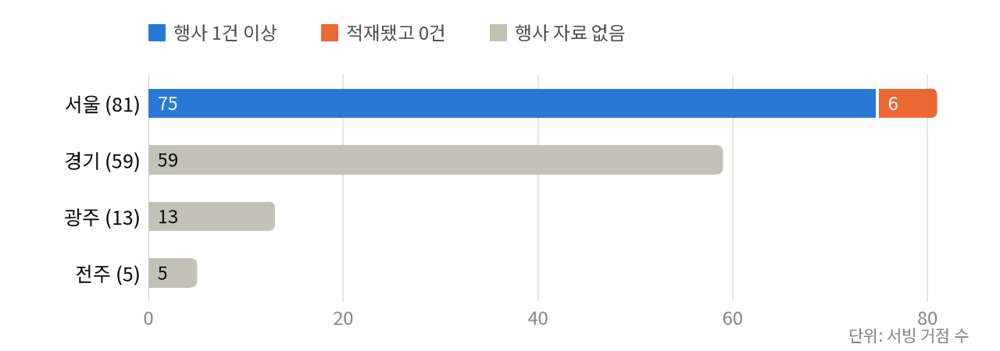
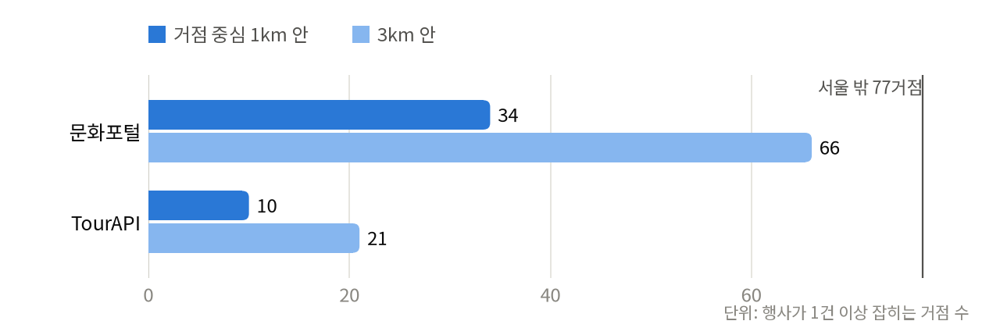
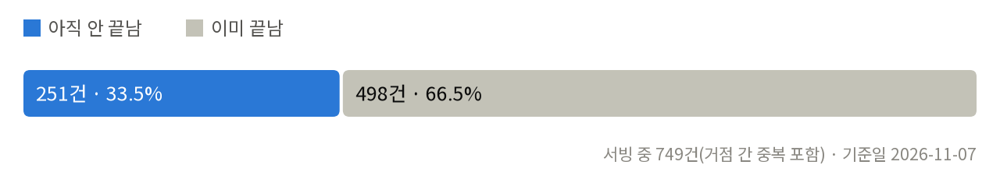

# Program 리뉴얼 — 검증 결과와 수정·연동 계획

작성 2026-11-07 · 대상 트랙 Program(Promotion ▶ Program) · 근거는 저장소 산출물, 외부 API 1콜 실측, 공식 명세다.

수치의 단일 출처는 둘이다. `python scripts/pppp_status.py`(2026-11-07 실행)와 `python scripts/program_renewal_probe.py --as-of 2026-11-07 --live`(결과 `reports/program_renewal_probe_2026-11-07.json`). 이 문서의 숫자는 낡는다 — 인용하기 전에 두 스크립트를 다시 돌린다.

**2판(2026-11-07, 키 신청 뒤)** — K-Startup·정부24 혜택은 활용신청이 반영돼 공용 키로 200 을 받았다. 기업마당은 API 가 둘(지원사업정보·행사정보)이고 키도 둘이라 나눠 적었다 — 1판은 행사정보 API 를 빠뜨렸다. 사용자가 「이 보고서를 바탕으로 리뉴얼을 마무리」하라고 지시해 다섯 결정은 권고안대로 진행한다(D3 의 사용자끼리 연결은 권고대로 보류). 1판과 달라진 곳은 3-4 끝에 모았다.

**3판(2026-11-08, 구현 뒤)** — 사용자 지시(「작업을 마무리할 것」)로 이 보고서대로 구현했다. 4장의 완료 조건을 실행 결과로 대조한 표와, 구현하면서 실측으로 고친 것·남은 것은 5장에 모았다. 1~4장은 2판 그대로다(5장이 다르게 말하면 5장이 맞다).

## 0. 핵심 요약

**결론 — 리뉴얼은 진행할 수 있다. 다만 세 조건을 지킬 때다.**

- **화면은 갈아끼우지 않고 안을 바꾼다.** Program 트랙은 계속 `pages/CampaignStudio` 모듈을 그리고, 네 기능(네트워킹 · 지원 프로그램 · 오프라인 마케팅 솔루션 · 가설 검증)은 그 모듈 안의 탭이 된다. 지금 있는 캠페인 원장·검증 브리프·행사 연계·종합 리포트는 지우지 않고 새 기능 아래로 옮긴다. 이렇게 하면 PPPP 화면 보존 가드를 고칠 일이 없다.
- **네트워킹은 공식 네트워크와 방문형 이웃 가게부터 시작한다.** PlaceOS 가 기존 사업자의 연락처를 모으거나 대신 연락하지 않는다(정보통신망법 제50조 — 영리 목적 광고성 정보는 명시적 사전 동의). 사용자끼리 잇는 기능은 옵트인과 이메일 소개로, 처리방침을 고친 뒤 마지막 단계에 붙인다.
- **오프라인 마케팅은 데이터 공백부터 메운다.** 지금 행사 자료는 서울 81거점에만 있고 서울 밖 77거점은 0건이다. 이미 키가 활성인 문화포털 API 로 서울 밖 34거점에 1km 안 행사가 잡힌다. 그리고 지금 서빙되는 행사 749건 중 498건(66.5%)은 2026-11-07 기준 이미 끝났다. 이 결함부터 고친다.

| 기능 | 지금 있는 것 | 새로 필요한 것 | 판정 |
|---|---|---|---|
| 네트워킹 | 캠페인 원장의 「협업 후보 등록」(출처·확인일 필수) · 주변 업종 조회(nearby-stores) · 업종 동반 출현(lift) | K-Startup 「행사ㆍ네트워크」 공고 · 기업마당 행사정보(교육·세미나·전시회) · 지원기관·전통시장 디렉터리 · (3단계) 옵트인 연결 | 조건부 — 1·2단계는 바로, 3단계는 결정 D3 |
| 지원 프로그램 | 없음 | K-Startup·정부24 혜택·기업마당 지원사업정보 연동 + 거점·단계·업종 매칭 규칙 | 착수 — 공용 키 200(승인 반영) · 기업마당 두 키 발급 · 서버 키는 배포 때 |
| 오프라인 마케팅 솔루션 | 행사 연계 계획(EventLinkPlanner) · 검증 program 오프라인 채널 · 캠페인 원장 | 행사 종료 필터 · 전국 행사(문화포털·TourAPI) · 실행 카드 | 바로 착수 — 대상 범위는 결정 D2 |
| 가설 검증 | 검증 브리프·판정표(ProgramStudio) · Posting 계산 인계 · 종합 리포트(PpppReport) | 목표선을 Posting 본전에서 유도 · 세 기능 결과를 판정 입력으로 · 판정 기록 계측 | 바로 착수 — 09-17 계약 유지 |

> **사람 몫 — 키·신청 5건(2판: 상태 갱신)**
> ① data.go.kr 15125364(K-Startup) — 완료. 승인 반영, 공용 키로 200(전체 30,540건 · 모집 중 213건)
> ② data.go.kr 15113968(정부24 공공서비스·혜택) — 완료. 승인 반영, 공용 키로 200(10,942건)
> ③ 기업마당 — 완료(사용자 보고). 키 둘: 지원사업정보 → `BIZINFO_SUPPORT_API_KEY` · 행사정보 → `BIZINFO_EVENT_API_KEY`
> ④ NAVER API HUB — 완료(사용자 보고). `NAVER_HUB_CLIENT_ID` · `NAVER_HUB_CLIENT_SECRET` — 옛 `NAVER_CLIENT_*` 는 그대로 둔다
> ⑤ Cloud Run 환경변수 — **완료(2026-11-08 · 사용자 지시)**. 세 키를 `--update-env-vars` 로 더했고(NAVER HUB 는 서버가 안 읽어 뺐다),
> 기업마당은 Cloud Run 고정 출구 IP(ODsay 용 Cloud NAT)에서 `ok` 였다 → docs/api-keys-and-specs.md §8-G

| 결정 | 선택지 | 권고 |
|---|---|---|
| D1 Program 정의 교체 | CLAUDE.md PPPP 표·program 스킬·랜딩 문구를 새 질문으로 | 승인 시 구현 PR 에서 함께 고친다 |
| D2 오프라인 마케팅의 대상 | (a) 검증·개업 단계 창업자 / (b) 영업 중 가게까지 | (a) — 정체성 「계약 전에」와 09-17 재정의에 맞다. (b) 는 09-17 결정을 철회해야 한다 |
| D3 사용자끼리 연결(옵트인) | 도입 / 보류 | 파일럿이 붙은 뒤 도입 — 지금은 상대가 없다 |
| D4 종합 리포트 위치 | 가설 검증 안 / 다섯째 탭 | 가설 검증 안 — 기능 이름 넷을 지킨다 |
| D5 NAVER API HUB 이관 | 이번 리뉴얼에 포함 / 따로 | 포함 — 오프라인 마케팅의 온라인 근거가 이 키에 걸려 있다 |

2판: 사용자 지시(「수정한 내용을 바탕으로 리뉴얼을 마무리」)에 따라 다섯 결정은 위 권고대로 진행한다. D3 은 「파일럿이 붙은 뒤 도입」이 권고라 사용자끼리 잇는 3단계는 이번에 만들지 않는다.

<!-- pagebreak -->

## 1. Program 을 어떻게 수정해야 하나

### 1-1 정의를 바꾼다

| 항목 | 지금 (2026-09-17 정본) | 리뉴얼(안) |
|---|---|---|
| 묻는 질문 | 이 아이템이 이 platform 에서 통하는지, 온·오프라인에서 어떤 검증 program 으로 확인할 것인가? | 이 상권에서 **누구와 연결하고, 무엇을 지원받고, 어떻게 알리며**, 그 결과로 아이템이 **통하는지 어떤 기준으로 판정**할 것인가? |
| 기능 | 검증 program 생성(모객·자리·연계·검증 지표) + 오프라인 캠페인 원장 | 네트워킹 · 지원 프로그램 · 오프라인 마케팅 솔루션 · 가설 검증 |
| 대상(사용자) | 예비창업자 · 팝업·가오픈·MVP 로 검증하려는 기창업자 | 그대로. 기존 사업자·상인 조직·지원기관은 **상대방**이지 사용자가 아니다 |
| 결론 | 검증 지표(지표·측정 방법·목표선·기각 조건) | 그대로. 가설 검증의 판정표가 Program 의 결론이다 |

네 기능은 창업자가 그 상권에서 돌릴 program 들이다 — 사람(네트워킹), 제도(지원 프로그램), 실행(오프라인 마케팅 솔루션), 판정(가설 검증). 앞의 셋이 가설 검증에 재료를 넘기고, 가설 검증은 시작 전에 고정한 기준으로 계속·보류·중단을 가른다. 「지표가 결론이다」라는 09-17 원칙은 그대로 둔다.

### 1-2 화면 구조 — Program 허브 안의 네 탭

지금 Program 트랙은 `App.tsx` 의 ConsolePages 4장(캠페인 운영 · 검증 계획 · 온·오프라인 행사 연계 · 검증 리포트)이고, 첫 장이 `pages/CampaignStudio` 다. PPPP 화면 가드(`src/ppppScreens.test.tsx`)는 레일의 Program 버튼이 **그 모듈**을 그리는지만 본다.

| 지금 | 리뉴얼 뒤 자리 |
|---|---|
| — | **네트워킹** (신규) |
| — | **지원 프로그램** (신규) |
| 온·오프라인 행사 연계 (EventLinkPlanner) | **오프라인 마케팅 솔루션** › 실행 계획 |
| 캠페인 운영 (CampaignStudio 원장) | **오프라인 마케팅 솔루션** › 실행 기록 |
| 검증 계획 (ProgramStudio) | **가설 검증** › 검증 계획 |
| 검증 리포트 (PpppReport) | **가설 검증** › 결과 리포트 (결정 D4) |

- **권고(A)** — `pages/CampaignStudio.tsx` 를 Program 허브로 바꾸고 네 탭을 이 모듈 안에서 그린다. 지금의 캠페인 원장은 `components/program/CampaignLedger.tsx` 로 옮겨 「실행 기록」에서 그린다. App 은 계속 CampaignStudio 하나만 부르므로 가드는 수정 없이 통과한다.
- (B) — App 의 ConsolePages 를 두고 첫 장을 CampaignStudio 로 남긴 채 이름만 바꾼다. 첫 화면이 「실행 기록」이 되어 리뉴얼 순서(네트워킹이 먼저)와 어긋난다.
- 네 탭 모두 **로그인 없이 열람**한다(보존 규칙 ⑤). 저장·옵트인·LLM 생성만 로그인을 요구한다 — 지금 규칙(10-03 LLM 문) 그대로다.
- 트랙 머리 이름표 「오프라인 캠페인」(TrackMapFrame label)은 「Program」으로 바꾼다. 랜딩 #how 의 Program 질문 문구도 바꾸되 「4. Program」 이름과 펼친 상태는 유지한다(가드 ④).

### 1-3 네트워킹

| 항목 | 내용 |
|---|---|
| 묻는 질문 | 이 상권에서 계약 전에 누구에게 묻고, 개업 뒤 누구와 함께할 수 있나? |
| 1단계 · 공식 네트워크 | 소상공인지원센터(소진공 본부·지역센터 파일 15099943) · 전통시장(전국전통시장표준데이터 15012894 — 시장명·좌표·점포수·전화·홈페이지) · K-Startup 공고 중 지원분야 「행사ㆍ네트워크」 · **기업마당 행사정보 API**(중소기업 대상 교육·세미나·전시회·사업설명회 — 좌표가 없어 거리순이 아니라 지역 해시태그로 거른다) · 창조경제혁신센터·지자체 창업 지원센터(공개 API 를 확인하지 못했다 — 공식 누리집 목록을 출처·확인일과 함께 손으로 정리). 거점에서 가까운 순으로, 기관 대표 연락처와 원문 링크만 싣는다 |
| 2단계 · 이웃 가게(방문형) | 공개 상가정보로 같은 업종·보완 업종 가게를 지도에 보이고, 「방문해서 물어볼 질문」(권리금 관행 · 임대인 응대 · 상인 조직 규칙 · 피크 시간)을 준다. 보완 업종은 `platform_industry_colocation.json` 의 동반 출현(lift)을 쓰되 그 파일의 문구 「관측일 뿐 인과·매출 효과가 아니다」를 그대로 붙인다 |
| 3단계 · 동네 창업자 연결(옵트인) | 같은 거점을 저장한 가입자가 「연결 허용」을 켠 경우에만 거점 단위로 보인다(정확한 위치는 보이지 않는다). 연결 요청 → 양쪽 동의 → 이메일 소개. 앱 안 채팅은 만들지 않는다(가벼운 대안 먼저 · 2026-10-05) |
| 금지 | 상가정보 상호로 연락처를 찾아 연락 대행 · 개인 연락처 저장(협업 후보 「문의 창구」는 기관·사업상 창구만 — 지금 원장 규칙) · 이웃 가게 평점·순위 매기기(공생 원칙) |
| 저장 | 1·2단계는 Gold·기존 서빙 경로(개인정보 0). 3단계는 계정층 DB 새 표 → 처리방침(privacy.html) · PrivacyNote · `auth_service.delete_account` · 처리방침 표 사전 테스트를 같은 PR 에서 고친다(10-14 캠페인 표와 같은 절차) |
| 계측 | 디렉터리 원문 클릭 · 질문 목록 저장 · (3단계) 연결 요청·양측 수락. 원문 링크 클릭은 W4 「분석 접근」에 넣을지 먼저 정한다(피드백 오염 정정 10-19 와 같은 문제) |
| 완료 조건 | 서빙 거점 중 디렉터리 1건 이상인 거점 수를 pppp_status 게이트로 센다 · 연락처 필드가 응답에 없음을 테스트로 잠근다 |

### 1-4 지원 프로그램

| 항목 | 내용 |
|---|---|
| 묻는 질문 | 내 단계·업종·지역에 지금 신청할 수 있는 국가·지자체 지원은 무엇이고, 언제 마감인가? |
| 소스 | K-Startup 지원사업 공고(15125364) · 정부24 공공서비스(혜택)(15113968) · 기업마당 지원사업정보(`bizinfoApi.do` · 키 `BIZINFO_SUPPORT_API_KEY`) · 필요할 때 지자체 개별 데이터(예: 경기도 안산시_중소기업소상공인지원정보 15160004 — 시·군마다 형식이 다르다) |
| 매칭 규칙(LLM 없음) | 거점의 시도·시군구 ↔ 공고 지역(K-Startup `supt_regin`) · 「내 사업」 목적 ↔ 창업 기간(`biz_enyy` — 예비창업자·1년미만…7년미만, 정부24 지원조건 JA1101 예비창업자·JA1102 영업중) · 업종 ↔ 지원 분야·대상 문구 · 모집 중(`rcrt_prgs_yn`)·마감일 |
| 보이는 것 | 공고명 · 주관기관 · 마감일 · 지원 내용 원문 발췌 · 원문 링크 · **조회 시각**. 「조건이 맞을 수 있는 공고」라고 부른다 — 자격 판정이나 선정 가능성은 표시하지 않는다 |
| 금액 규칙 | 금액은 공고 원문에 있는 것만 인용한다. HA 가드 `fabricated_price` 의 허용 근거에 공고 원문을 더한다 |
| Posting 과의 관계 | 지원금은 Posting 회수기간 계산에 **넣지 않는다** — 선정 전 금액을 넣으면 실측처럼 보이는 추정이 된다. 「선정되면 공고 한도가 초기 투자의 몇 %」 같은 조건부 문장만 쓴다 |
| 가설 검증과의 관계 | 시제품·팝업·판로 지원 공고는 검증 브리프의 예산 칸 옆에 「검증 자금 후보」로 보인다 |
| 갱신 | 공고는 매일 바뀐다. 서버 조회 + 프로세스 TTL 캐시(예: 6시간 — 고른 값) + 조회 시각 표시. 실패하면 「지금 확인할 수 없음 + 원문 포털 링크」를 보이고 지난 목록을 최신처럼 보이지 않는다. ⚠ 지금 백엔드 설정(`core/config.py`)에는 data.go.kr 키가 없다 — 수집기만 `data/.env` 로 쓴다. 서버에서 부르려면 Cloud Run 에 키를 시크릿으로 더해야 한다(2-5). 두 공공 API 는 이용허락범위 제한 없음이라 Bronze 스냅샷 보관도 된다 |
| 계측 | 공고 원문 클릭 · 저장 수 |
| 완료 조건 | 키 3종 활성 · 서빙 4개 시도(서울·경기·전남광주·전북)별 모집 중 공고 1건 이상 확인 · 매칭 규칙 단위 테스트 · 금액 인용 HA 테스트 |

### 1-5 오프라인 마케팅 솔루션

| 항목 | 내용 |
|---|---|
| 묻는 질문 | 이 상권의 콘텐츠와 온라인 데이터로 볼 때, 검증·개업 기간에 언제·어디서·누구와·무엇을 하면 실행할 수 있나? |
| 대상(결정 D2) | 권고 (a) — 팝업·가오픈·개업 첫 회차. 영업 중 가게의 일반 마케팅은 09-17 결정대로 범위 밖이다 |
| 입력 | ① 지역 콘텐츠 — 행사(서울 문화행사 Gold + 신규 문화포털·TourAPI) · 전시회·박람회 참가 후보(기업마당 행사정보) · 전통시장 · 학원가(NEIS 학원·교습소 — 서울교육청 자료) ② 시간대 — 서울 생활인구 · 경기 유동(경기데이터드림 — 10-26 확인 때 2025-06 까지) · TRDAR 수요신호(서울) ③ 온라인 — 네이버 블로그·카페·뉴스 검색 표본(제목·링크만) · 데이터랩 검색어 추이(방향은 서버가 확정) ④ 자리 — Page·Posting 인계 ⑤ 예산 — 브리프의 예산 구간 |
| 출력 · 실행 카드 | 언제(빈 시간대 근거) · 어디서(행사·시설까지 거리) · 누구와(네트워킹 후보) · 무엇을(채널·제공 가치) · 예산 비율(int 퍼센트) · **측정 장치**(쿠폰 코드·QR·방문 계수기 — 가설 검증의 지표로 넘긴다). 카드마다 근거 출처와 조회일을 붙인다 |
| 그대로 쓰는 것 | 행사 cite/propose/own 구분(§0-F) · 온라인은 창업자 단독, 오프라인은 협업 주체 병기 · 캠페인 원장(합의·참여 증빙 · 비용·결과 · 수동 결제 증빙) |
| 먼저 고칠 결함 | 행사 서빙에 날짜 필터가 없다. `events.for_district` 와 `marketing._events_context` 가 기준일을 보지 않아 끝난 행사를 「예정 행사」로 싣는다(3-1) |
| 금지 | `app/data/seoul_pages.py` 시드 행사 사용(「유입 +34%」 같은 근거 없는 효과 지표가 남아 있다 — 제거 권고) · 상대의 참여 의사 단정 · 현수막·입간판을 바로 권하기(옥외광고물 허가·신고 대상일 수 있어 「지자체 확인」 안내를 붙인다) |
| LLM | 실행 카드 문장에만, 로그인 호출에만(10-03 LLM 문) · 규칙 스텁 폴백 · HA 가드(`trend_contradiction` · `fabricated_price` · `unproven_experience_claim` · `competitor_disparagement`) 유지 |
| 완료 조건 | 서빙 시 종료 행사 0건 · 서울 밖 거점의 지역 콘텐츠 커버리지 게이트 · 근접 행사 0 거점은 「확인된 지역 콘텐츠 없음 — 매장 자체 접점」 문구 |

### 1-6 가설 검증

| 항목 | 내용 |
|---|---|
| 묻는 질문 | 위 셋으로 무엇을 시험하고, 어떤 결과면 계속·보류·중단하는가? |
| 입력 | 검증 브리프(아이템 · 방식 popup/soft_open/mvp · 단계 · 가설 · 기간 · 예산 구간 · 차별점) · Posting 인계(월 손익분기 매출 등 계산 결과) · 네트워킹 기록(인터뷰 메모 — 사용자 입력) · 지원 프로그램 선정 여부(사용자 입력) · 오프라인 마케팅 실행 기록(캠페인 원장) |
| 바꿀 점 | 지금 규칙 스텁의 목표선은 고정값이다 — 팝업 「일 60명」·「70% 미만이면 기각」, MVP 「전환율 8%」·「4% 미만이면 기각」(`services/marketing.py`). 이 값은 그 자리의 본전과 관계가 없다. 리뉴얼에서는 **목표선을 Posting 본전에서 유도**한다(본전 매출 ÷ 객단가 = 하루 필요 건수). 기각선 비율은 창업자가 시작 전에 고르게 하고 「고른 값」이라고 표시한다 — 10-13 확인 ⑤ 시안이 이 방향이었다 |
| 출력 | 시작 전에 고정한 판정표(지표 · 측정 방법 · 목표선 · 기각 조건 — 바꾸려면 새 회차) · 결과 판정(통과 · 보류 · 기각 · 표본 부족이면 판정 보류) · 결과 리포트(PpppReport 에 네 기능 절 추가) |
| 신사업·새 아이템 | 기창업자의 업종 전환·이전도 같은 틀이다(`stage=founder`) |
| 계측 | CLAUDE.md 가 「아직 KPI 가 아닌 창업자 축」으로 둔 「시험 실행·판정 기록」의 계측기가 이 기능이다(KPI 규칙 4) |
| 완료 조건 | 실행 뒤 기준 변경 불가 테스트(캠페인 원장의 「합의 뒤 조건 고정」과 같은 규칙) · 본전 인계가 없으면 목표선을 비워 두고 「Posting 계산 필요」로 표시하는 테스트 |

### 1-7 서버·데이터 변경(안)

| 구분 | 파일(안) | 내용 |
|---|---|---|
| 서비스 | `services/support_programs.py` | K-Startup · 정부24 · 기업마당 클라이언트 + 매칭 규칙 + TTL 캐시 |
| 서비스 | `services/network_directory.py` | 지원기관 · 전통시장 · 행사·네트워크 공고 · 기업마당 행사정보 → 거점 근접(또는 지역) 순 |
| 서비스(3단계) | `services/network_intros.py` + `models` | 옵트인 프로필 · 소개 요청 · 양측 동의 · 탈퇴 시 삭제 |
| 라우터 | `api/v1/program_*.py` | `/api/v1/program/support` · `/program/network` · `/program/content` — 캠페인 API(`/api/v1/program/campaigns`)와 같은 접두어 |
| 수집 | `data/collectors/culture_portal.py` · `tourapi_festivals.py` | 전국 행사 → Bronze → Silver → `gold/platform_events.json` 확장. 응답 구조는 유지하고 `events_source` 값을 더한다 — **프론트가 지금 `seoul-open-data` 만 보여 주므로** CampaignStudio·EventLinkPlanner 의 출처 필터를 같이 고친다 |
| 수집 | `data/collectors/support_centers.py` · `traditional_markets.py` | 지원기관·전통시장 → `gold/platform_network_directory.json` |
| 설정 | `core/config.py` · `.env.example` | 백엔드에 `DATA_GO_KR_SERVICE_KEY` 신설(지금은 수집기 쪽에만 있다 — K-Startup·정부24 는 이 키에 활용신청만) · 기업마당 두 키(`BIZINFO_SUPPORT_API_KEY` · `BIZINFO_EVENT_API_KEY`) · NAVER HUB 키(`NAVER_HUB_CLIENT_ID/SECRET`) |

### 1-8 같은 PR 에서 고칠 문서·규칙

- `CLAUDE.md` PPPP 표의 Program 행과 한 줄 요약(결정 D1) — §PPPP 화면 보존 규칙 본문은 바꾸지 않는다(모듈이 그대로라서)
- `.claude/skills/program/SKILL.md` — 트랙 정의 · 입력 계약 · 화이트리스트 경로 · 엔드포인트
- `docs/feature-program.md` §0-W 신설 — 09-17 §0-V(「영업 중 가게 마케팅은 이 트랙이 아니다」)와 10-14 `feature-program-campaigns.md`(점주 운영 여건 입력)의 어긋남을 정본 하나로 정리
- `docs/api-keys-and-specs.md` §8 — 새 키·활용신청·NAVER HUB
- `scripts/pppp_status.py` Program 게이트 — 지원 공고 연결 · 네트워크 디렉터리 커버리지 · 서울 밖 지역 콘텐츠 커버리지 · 행사 신선도
- (3단계) 처리방침 · PrivacyNote · 탈퇴 삭제

## 2. 무엇을 연동해야 하나

### 2-1 기능별 데이터·API 연동표

상태는 2026-11-07 1콜 실측이다(2판은 키 신청 뒤 다시 쟀다). 「공용 키」는 data.go.kr 의 `DATA_GO_KR_SERVICE_KEY` 하나를 뜻한다 — 같은 키로 API 마다 활용신청만 따로 한다. 호출 주소는 부록 A 에 모았다.

| 기능 | 소스(제공 · 번호) | 키·상태(실측) | 이용 조건 · 메모 |
|---|---|---|---|
| 지원 | K-Startup 지원사업 공고(창업진흥원 · 15125364) | **공용 키 200** — 승인 반영(모집 중 213건) | 이용허락범위 제한 없음 · 무료 · 실시간 |
| 지원 | 정부24 공공서비스(혜택)(행정안전부 · 15113968) | **공용 키 200** — 승인 반영(10,942건) | 이용허락범위 제한 없음 · 무료 · 실시간 · 지자체 서비스 포함 |
| 지원 | 기업마당 지원사업정보(`bizinfoApi.do`) | 키 발급(`BIZINFO_SUPPORT_API_KEY`) · 키 없이 200 「인증키를 입력해주세요」 | 기관별·분야별 지원사업 공고 · 인자 `crtfcKey` · 지역·분야 `hashtags` · 신청서의 IP 조건 |
| 네트워킹 | 기업마당 행사정보(`bizinfoEventApi.do`) | 키 발급(`BIZINFO_EVENT_API_KEY`) · 키 없이 200 | 교육·세미나·전시회·사업설명회 · 지역 `hashtags` · 좌표 없음(지역 단위) |
| 지원 | 지자체 개별 데이터(예: 안산시 15160004) | 미확인 | 보완용 — 기업마당이 그 지자체 공고를 이미 모으는지 먼저 본다 |
| 네트워킹 | K-Startup 「행사ㆍ네트워크」 분야 | 위 공고 API 와 같다 | 지원 분야 필터(`supt_biz_clsfc`) |
| 네트워킹 | 전국전통시장표준데이터(소진공 · 15012894) | 미호출 | 시장명·좌표·점포수·전화·홈페이지 · 상인회 항목은 없다 |
| 네트워킹 | 소진공 본부·지역센터 정보(15099943) | 미호출(파일) | 지원기관 디렉터리 |
| 네트워킹 | 상가정보 점포 · 업종 동반 출현 | 보유 | `nearby-stores` · `platform_industry_colocation.json` — 공개 상가정보, 연락처 없음 |
| 마케팅 | 서울 문화행사(culturalEventInfo) | 보유 — 적재 2026-10-11 | 서울만 · 서빙 날짜 필터 없음(3-1) |
| 마케팅 | 문화포털 기간별 문화정보(B553457) | **공용 키 200** · 1,181건(좌표 1,038) | 전국 · 쪽 인자가 `numOfrows`·`PageNo`(대소문자 그대로) |
| 마케팅 | TourAPI 축제·행사(한국관광공사) | **공용 키 200** · 조건 응답 130건 | 전국 · 좌표·기간·전화·이미지 저작권 유형(`cpyrhtDivCd`) |
| 마케팅 | 생활인구·유동 | 보유 | 서울 KT 생활인구 · 경기 유동은 표본이 2025-06 까지 · 광주·전주는 미확인 |
| 마케팅 | 네이버 검색(블로그·카페·뉴스)·데이터랩 | 보유 — **API HUB 이관 필요** | 2-3 참조 |
| 마케팅 | 인스타그램 해시태그 | 보류 유지 | 앱 검수 · 계정당 7일 동안 해시태그 30개 |
| 마케팅 | 카카오 로컬 | 보유 | 실시간 조회만 · 저장 금지(09-15 확인) |
| 공통 | LLM(anthropic SDK · `llm_model`) | 보유 | 로그인 호출만(10-03 LLM 문) |

### 2-2 지역 콘텐츠 공백 — 서울 밖 77거점

서빙 거점은 158곳이다(서울 81 · 경기 59 · 광주 13 · 전주 5). 지금 Program 의 오프라인 근거인 행사 자료는 서울 문화행사 하나라서 서울 밖 77거점에는 자료가 없다. 서울 안에서도 LLM 컨텍스트가 「걸어갈 거리」로 보는 500m(`marketing._WALKABLE_M`) 안에 행사가 있는 거점은 81곳 중 33곳이다.

이미 키가 활성인 두 전국 API 로 서울 밖 77거점이 얼마나 채워지는지 거점 중심에서 거리로 쟀다. 문화포털이 TourAPI 보다 훨씬 촘촘하다 — 1km 안에서 34곳 대 10곳이다. 문화포털을 먼저 붙이고 TourAPI 는 큰 축제 보완으로 쓴다. 3km 안에도 0건인 거점(문화포털 기준 11곳)은 「확인된 지역 콘텐츠 없음」으로 정직하게 보인다.

| 서울 밖 거점(77) | 문화포털 1km | 문화포털 3km | TourAPI 1km | TourAPI 3km |
|---|---|---|---|---|
| 경기(59) | 27 | 49 | 5 | 11 |
| 광주(13) | 3 | 12 | 3 | 8 |
| 전주(5) | 4 | 5 | 2 | 2 |
| 합계 | 34 | 66 | 10 | 21 |

거리는 거점 중심 좌표(`page_hubs` 의 cx·cy)에서 행사 좌표까지의 직선거리다. 문화포털은 조회 시점에 등록된 전체 목록, TourAPI 는 `eventStartDate=20261101` 조건 응답이다. 둘 다 기간이 지나면 바뀌므로 실제 반영 전에 다시 잰다.

### 2-3 온라인(SNS·IT) 데이터 — 무엇을 쓰고 무엇을 보류하나

| 데이터 | 판단 | 근거 |
|---|---|---|
| 네이버 블로그·카페·뉴스 검색 | **쓴다 — 단 API HUB 로 옮긴다** | NAVER API HUB 이관 가이드(공식): 기존 개발자센터 Client ID/Secret 으로는 HUB 를 부를 수 없고, 도메인(`naverapihub.apigw.ntruss.com`)과 인증 헤더(`X-NCP-APIGW-API-KEY-ID`·`X-NCP-APIGW-API-KEY`)가 바뀐다. 2차 출처: 기존 키 호출은 2027-06-30 까지, HUB 는 종량 요금(지금은 한시 무료) |
| 데이터랩 검색어 추이 | 쓴다 — 같은 이관 대상 | `_trend_summary` 가 방향을 확정하고 HA 가드가 역행 주장을 막는 구조는 그대로 |
| 검색 표본의 해석 | 「수요」가 아니라 「검색 표본」 | 10-11 수집 자료 문서: 광고성·실제 지역 귀속을 검증한 리뷰가 아니다. 제목·링크만 싣고 본문은 싣지 않는다 |
| 인스타그램 해시태그 | 보류 유지 | Meta 공식 문서: Instagram Public Content Access 앱 검수 필요 · 비즈니스/크리에이터 계정당 7일 동안 고유 해시태그 30개 · 스토리 해시태그 미지원 |
| 카카오 로컬 | 현존 점포 확인에만 | 응답 저장 금지(약관) — 실행 카드의 근거로 저장하지 않는다 |
| 유료 통합 언급량(썸트렌드 등) | 쓰지 않는다 | 무료 원칙(2026-10-26 확장 결정) · 재배포 조건 미확인 |

### 2-4 MCP — 런타임에는 넣지 않고 개발에 쓴다

**런타임(서비스가 매일 쓰는 길)은 MCP 가 아니라 공식 API 를 직접 부르고 Bronze → Silver → Gold 로 싣는다.** 이유는 셋이다.

- **근거가 응답에 남아야 한다.** 실행 카드와 공고 목록은 출처·조회일·원문 링크를 함께 실어야 하고, HA 가드는 대조할 원문이 있어야 돈다. LLM 이 MCP 도구를 부르게 하면 근거가 모델 호출 안으로 숨는다.
- **공식 MCP 가 없다.** 2026-11-07 검색으로 data.go.kr·한국관광공사·창업진흥원의 공식 MCP 서버는 확인하지 못했다. 보이는 것은 커뮤니티 서버이고, 그중 하나(startup-helper-mcp)는 「통계 기반 추정」 인구·포화도를 섞어 낸다 — 실측처럼 보이는 추정은 이 저장소가 가장 나쁘게 보는 산출물이다.
- **재현성과 비용.** 같은 질문에 같은 답이 나와야 판정표가 의미가 있다. 매칭은 규칙으로, 문장만 LLM(로그인 호출)으로 만든다.

| 용도 | MCP | 상태(이 세션) | 쓰는 곳 |
|---|---|---|---|
| 개발 · 명세 확인 | fetch | 연결됨 — 이번 검증에 사용 | API 명세·공고 원문 확인 |
| 개발 · 실화면 검사 | claude-in-chrome / playwright · chrome-devtools | chrome 확장은 쓸 수 있음 · playwright·devtools 는 연결 실패 | 리뉴얼 화면의 실화면 확인(`scripts/pppp_screens_check.py` 와 함께) — playwright·devtools 는 재연결 필요 |
| 개발 · 화면 시안 | Figma | 연결됨 | 네 탭 화면 시안 |
| 개발 · 작업 알림 | 카카오 PlayMCP(나에게 보내기) | 연결됨 | 무인 수집 완료 알림. 제품 알림은 이메일 먼저 원칙 그대로(알림톡 금지) |
| 탐색(선택 · 비공식) | naver-search-mcp(isnow890) · data-go-mcp-servers(Koomook) · mcp-korea-tourism-api(harimkang) · startup-helper-mcp(re171113-byte) | 미설치 | 소스 탐색에만. 수치 인용 금지 · 설치 전 코드 확인 · 키는 환경변수로 분리 |
| 나중(선택) | PlaceOS 자체 MCP 서버 | 없음 | 거점·빈 자리·지원 공고 매칭을 외부 AI 창업 코파일럿에 내보내는 표면 — Posting 의 외부 코파일럿 어댑터와 같은 방향. 파일럿이 붙은 뒤 |

### 2-5 키·신청 체크리스트(사람 몫)

2판 상태: 1·2 완료(공용 키 200) · 3·4 발급 완료(사용자 보고 — 키 값으로 1콜은 아직) · 5 는 배포 때.

| 순서 | 할 일 | 막는 것 | 메모 |
|---|---|---|---|
| 1 | data.go.kr 15125364 활용신청 | 지원 프로그램 · 네트워킹 행사 | 공용 키에 추가. 승인 뒤 반영까지 시간이 걸릴 수 있다 |
| 2 | data.go.kr 15113968 활용신청 | 지원 프로그램(지자체 혜택) | 포털 표기상 개발·운영 자동승인 |
| 3 | 기업마당 정책정보 개방 신청 — 지원사업정보·행사정보 두 건 | 지원 프로그램(부처·지자체 공고) · 네트워킹(행사) | 키가 API 마다 따로 나온다. 시스템 IP 를 적는다 — Cloud Run 은 고정 출구 IP 가 기본이 아니다. 로컬 수집기 → Gold 경로로 쓸지, 고정 IP(비용)를 둘지 신청 전에 정한다 |
| 4 | NAVER API HUB 앱 등록 | 온라인 근거 전체 | 네이버 클라우드 가입·결제수단 등록이 필요하다는 2차 출처가 있다 · 새 키 이름을 따로 두고 기존 키는 기한까지 유지 |
| 5 | Cloud Run 에 `DATA_GO_KR_SERVICE_KEY` 시크릿 추가 | 서버에서 공고를 부르는 길 | 외부 서비스 설정 변경이라 사람 몫 · `--set-env-vars` 금지(기존 값이 날아간다 — deploy 문서) |
| 6 | (선택) 전통시장·지원센터 파일 내려받기 | 네트워킹 1단계 | 표준데이터는 매월 병합 — 갱신 주기를 기록 |

## 3. 검증 기록 — 3회 + 교차 1회

### 3-1 검증 1 · 정합성 — 정체성·PPPP 규칙·기존 결정·지금 코드와 맞는가

| 점검 | 결과 | 설계에 반영한 것 |
|---|---|---|
| 정체성 「계약하기 전에」 | 네 기능 모두 계약 전·개업 직전 결정에 닿게 정의할 수 있다. 오프라인 마케팅이 「영업 중 가게 홍보」로 읽히면 어긋난다 | 대상 범위를 결정 D2 로 떼고 권고를 (a) 검증·개업 단계로 |
| PPPP 화면 보존 규칙 | 가드는 Program 버튼이 `pages/CampaignStudio` 모듈을 그리는지만 본다. 지금은 그 모듈이 ConsolePages 첫 장이다 | 네 기능을 CampaignStudio 모듈 안으로(권고 A) — 가드 수정 없음 · 기존 기능은 지우지 않고 옮긴다 |
| 문서 간 모순 | CLAUDE.md·program 스킬·§0-V 는 「영업 중 가게 마케팅은 이 트랙이 아니다」(09-17)인데, 10-14 부터 기본 화면인 캠페인 원장은 「점주 · 실제 영업 주소 · 매장 운영 여건」을 받는다 | §0-W 로 정본을 하나로(1-8) |
| 가벼운 대안 먼저(10-05) | 채팅·알림톡·PG 는 금지 축이다 | 네트워킹은 이메일 이중 동의 소개 · 결제는 지금의 수동 증빙 그대로 |
| KPI 규칙 1~4 | 계측기 없는 목표는 KPI 가 아니다 · 임계값은 발명하지 않는다 | 기능마다 계측 항목을 넣었다 · 가설 검증 목표선을 Posting 본전에서 유도(지금 스텁은 고정값) |
| 실측처럼 보이는 합성값 금지 | `seoul_pages.py` 시드 행사에 근거 없는 효과 지표가 남아 있고, 행사 Gold 가 없으면 `seed` 로 폴백한다(지금 프론트는 `seoul-open-data` 만 보여 준다) | 새 화면은 시드를 쓰지 않는다 · 시드 제거 권고 |
| **행사 신선도(결함)** | 행사 Gold 는 2026-10-11 적재본이고 서빙에 날짜 필터가 없다. 11-07 기준 749건 중 498건(66.5%)이 끝났고, 19거점은 실린 행사가 전부 끝났다. LLM 컨텍스트도 이 목록을 「예정 행사」로 싣는다 | 4장 1단계 첫 작업 |

### 3-2 검증 2 · 실현 가능성 — 데이터·API 가 실제로 있는가

공식 명세 페이지를 읽고, 엔드포인트마다 1콜을 쳤다(부록 A). 키 없이 부른 응답과 없는 오퍼레이션을 부른 응답을 대조해 「엔드포인트가 있다」와 「키가 등록됐다」를 갈랐다 — K-Startup 은 키 없이 401 `SERVICE_KEY_IS_NULL`, 없는 오퍼레이션은 400 `NO_OPENAPI_SERVICE_ERROR` 다.

| 소스 | 엔드포인트 | 공용 키 | 판정 |
|---|---|---|---|
| K-Startup 공고 | 있다 | 미등록(403) → 신청 뒤 200 | 바로 쓸 수 있다 |
| 정부24 혜택 | 있다(키 없이 401 「인증키는 필수」) | 미등록(401) → 신청 뒤 200 | 바로 쓸 수 있다 |
| 기업마당 지원사업정보 | 있다(200 「인증키를 입력해주세요」) | 해당 없음 — 별도 키 | 키 발급 · IP 조건 확인 |
| 기업마당 행사정보 | 있다(200 「인증키를 입력해주세요」 · 없는 주소는 404) | 해당 없음 — 별도 키 | 키 발급 · IP 조건 확인 |
| TourAPI 축제 | 있다 | 활성(200 · 130건) | 바로 쓸 수 있다 |
| 문화포털 | 있다 | 활성(200 · 1,181건) | 바로 쓸 수 있다 |
| 네이버 검색·데이터랩 | HUB 로 이관 중 | 기존 키는 HUB 에서 못 쓴다 | 새 키 필요 |
| 인스타그램 | 있다 | 앱 검수 필요 | 보류 |

명세에서 확인한 필터 — K-Startup 공고는 지역(`supt_regin`) · 창업 기간(`biz_enyy`, 예비창업자 포함) · 신청 대상 · 대상 연령 · 지원 분야(`supt_biz_clsfc`, 예시값 「행사ㆍ네트워크」) · 모집 진행 여부를 받는다. 정부24 혜택은 지원대상·선정기준·신청기한·소관기관유형을 주고, 지원조건 표에 예비창업자(JA1101)·영업중(JA1102)·생계곤란/폐업예정자(JA1103)·중소기업(JA2101) 같은 항목이 있다. 이 필터들이 1-4 의 매칭 규칙을 결정론으로 만들 수 있게 해 준다.

### 3-3 검증 3 · 반증 — 일부러 깨 보았다

| 반론 | 판정 | 설계 변경 |
|---|---|---|
| 「네트워킹은 사용자끼리 이으면 된다」 | 콜드스타트. KPI③ 계측은 섰지만 파일럿 실적은 아직 없다(pppp_status — 「배선 100% 는 파일럿 0 건과 양립」). 158거점에 나누면 거점마다 상대가 없다 | 공식 네트워크·방문형 이웃 가게부터, 사용자끼리는 3단계 |
| 「상가정보에 상호가 있으니 PlaceOS 가 대신 연락하면 된다」 | 정보통신망법 제50조 제1항 — 전자적 전송매체로 영리 목적 광고성 정보를 보내려면 명시적 사전 동의가 필요하다. 개인정보보호법 동의와는 별개다 | 연락 대행·연락처 수집 금지를 계약으로 정하고 테스트로 잠근다 |
| 「지원사업은 이미 K-Startup·기업마당·소상공인24 에 있다」 | 목록만 옮기면 중복이다 | 거점·단계·업종 매칭 + Posting 초기 투자 옆 조건부 비교 + 검증 자금 연결. 이 셋이 없으면 링크 모음이다 |
| 「지원금을 넣으면 회수기간이 짧아 보인다」 | 선정 전 금액을 계산에 넣으면 실측처럼 보이는 추정이 된다 | 회수기간에 넣지 않는다 · 「선정 시」 조건부 문장만 |
| 「지역 콘텐츠·SNS 로 실행안을 만든다」 | 서울 밖 77거점은 지금 행사 0건 · 인스타 막힘 · 네이버 이관 중 · 블로그 표본은 지역 귀속 미검증 | 문화포털·TourAPI 로 공백부터 · 표본은 「검색 표본」으로 · 근접 0 거점은 「자료 없음」 |
| 「기업마당은 서버에서 실시간으로 부르면 된다」 | 신청서가 시스템 IP 를 묻는다 · Cloud Run 은 고정 출구 IP 가 기본이 아니다 | 로컬 수집기 → Gold, 또는 고정 IP 비용 확인 — 신청 전에 결정 |
| 「MCP 로 다 붙이면 빠르다」 | 공식 MCP 없음 · 커뮤니티 서버는 추정치를 섞는 사례가 있다 · 근거가 LLM 호출 안으로 숨는다 | 런타임은 공식 API → Gold, MCP 는 개발용 |
| 「LLM 이 공고를 요약·추천하면 된다」 | 비용(로그인 호출 1회가 곧 Sonnet 1회) · 금액·자격 환각 위험 | 매칭은 규칙, 요약은 원문 발췌, LLM 은 실행 카드 문장에만 |
| 「검증 목표선은 지금 스텁으로 충분하다」 | 「일 60명」·「전환율 8%」는 자리의 본전과 무관한 고정값이다 — KPI 규칙 1 의 정신(임계값을 발명하지 않는다)에 어긋난다 | 목표선 = Posting 본전에서 유도, 기각선 비율 = 창업자가 시작 전에 고른 값으로 표시 |

### 3-4 검증 4 · 교차 검증 — 이 보고서 자체를 대조했다

- 이 보고서의 숫자는 세 출처 중 하나에 묶여 있다. ① `scripts/pppp_status.py` 출력(서빙 158거점 · Program 85.6% · 상권 콘텐츠 컨텍스트 117/158 · 상권 수요신호 81/158 · 검색 트렌드 라벨 117/158) ② `reports/program_renewal_probe_2026-11-07.json`(행사 커버리지·신선도 · API 응답 · 거점 근접) ③ 공식 명세 페이지(부록 B, 확인일 2026-11-07).
- 실측 스크립트는 worktree 의 산출물로 한 번, 메인 체크아웃 산출물로 한 번 돌려 거점·행사 수치가 같은지 대조했다(같음).
- **이 대조에서 첫 판의 오류 넷을 잡아 고쳤다.** ① 실측 스크립트가 「걸어갈 거리」를 300m 로 적었는데 코드의 기준(`services/marketing._WALKABLE_M`)은 500m 였다 — 상수를 소스에서 직접 읽게 고쳤고, 서울에서 그 거리 안에 행사가 있는 거점은 20곳에서 33곳으로 바뀌었다. ② 서버에서 공고를 부르려면 백엔드에 data.go.kr 키가 있어야 하는데 지금 `core/config.py` 에는 없다 — 1-4·1-7·2-5 와 요약의 사람 몫에 더했다. ③ NEIS 수집기는 학교가 아니라 학원·교습소(서울교육청) 자료다 — 1-5 입력을 고쳤다. ④ 기업마당 인증키 인자 이름은 비공식 코드에서만 봤다 — 「키 발급 뒤 확정」으로 낮췄다. 본문은 모두 고친 값이다.
- 본문 수치를 JSON·pppp_status 출력과 기계적으로 대조했다(19개 항목). 어긋난 것은 하나 — 문화포털의 좌표 있는 행사가 첫 실행 1,040건, 마지막 실행 1,038건이었다. 실시간 목록이라 한 시간 사이에도 바뀐다. 본문은 마지막 실행 값이고, 거점 근접 수(34·66)는 두 실행에서 같았다.
- 2차 출처는 표에 「2차 출처」라고 적었다 — 네이버 기존 키 기한·요금, NCP 가입 조건.
- 이 보고서가 하지 않은 것: 코드 수정·커밋·배포 · 프로덕션 DB · 활용신청(사람 몫) · 법률 판단(정보통신망법·개인정보 해석은 구현 전에 확인을 권한다) · 기업마당 키 값으로 1콜(키 값은 이 대화에서 보지 않았다 — 호출 주소·인자·응답 필드는 공식 명세로 확인했다).
- **2판에서 고친 것.** ① K-Startup·정부24 혜택 — 키 신청 뒤 공용 키로 다시 불러 둘 다 200 을 받았다(모집 중 공고 213건 · 혜택 10,942건, 쿼리 키·헤더 키 모두). K-Startup 응답에 매칭 규칙이 쓸 필드(`supt_regin` · `biz_enyy` · `supt_biz_clsfc` · `pbanc_rcpt_end_dt` · `detl_pg_url`)가 모두 있다. ② 기업마당 — 1판은 지원사업 API 하나로 적었다. 실제로는 지원사업정보(`bizinfoApi.do`)와 행사정보(`bizinfoEventApi.do`) 두 API 이고 키도 따로 발급된다. 둘 다 GET · 인증키 인자 `crtfcKey` · 지역·분야 `hashtags` 로 같고, 응답 필드는 다르다(공고명 `pblancNm`·신청기간 `reqstBeginEndDe` / 행사유형 `eventInfoTyNm`·행사기간 `eventPeriod`·지역 `areaNm`). 행사정보 API 는 네트워킹 1단계와 오프라인 마케팅(전시회·박람회)의 소스로 더했다. ③ 다섯 결정은 사용자 지시로 권고대로 진행한다.

## 4. 진행 순서와 완료 조건

| 단계 | 내용 | 완료 조건 | 규모 |
|---|---|---|---|
| 0 · 사람 몫 | 결정 D1~D5 · 키·신청(2-5) | 공용 키로 K-Startup·정부24 1콜 200 | — |
| 1 · 근거부터 | 행사 종료 필터(서빙 시점 기준일) · 문화포털·TourAPI 전국 행사 Gold · 지원 프로그램 탭(K-Startup → 정부24 → 기업마당 순) | 서빙 종료 행사 0건 · 서울 밖 지역 콘텐츠 게이트 · 4개 시도 모집 중 공고 1건 이상 | 중 |
| 2 · 허브 재구성 | CampaignStudio 안 네 탭 · 네트워킹 1·2단계 · 실행 카드 · 판정표 목표선 = Posting 본전 · 결과 리포트 확장 | PPPP 가드 무수정 통과 · 실화면 검사 · 연락처 필드 없음 테스트 · 기준 변경 불가 테스트 | 대 |
| 3 · 사람 잇기 | 옵트인 동네 창업자 연결(결정 D3) · 처리방침 개정 · 신고·차단 운영 | 탈퇴 시 삭제 테스트 · 양측 동의 전 정보 비공개 테스트 | 중 |

- 모든 단계의 「됐다」는 설명이 아니라 실행 결과로 닫는다 — 변경 파일 목록 + `/verify` 정적 3종(build → lint → test) + 바뀐 표면의 실제 응답. 흐름·App.tsx·레일을 건드리는 2단계는 실화면 검사(`py -3.11 scripts/pppp_screens_check.py`)까지 돌린다.
- KPI 와의 관계: 네 기능은 새 KPI 를 바로 만들지 않는다. 쓰임은 KPI③(W4 활성 · NPS · 돈을 낼 의향)으로 보고, 가설 검증의 판정 기록이 「시험 실행·판정 기록」 축의 첫 계측기가 된다.

## 5. 구현 결과 (2026-11-08)

작업 위치는 worktree `program-renewal`(브랜치 `docs/program-renewal-report-20261107`)이고, **커밋·배포 전**이다. 이 장의 숫자는 아래 명령의 11-08 출력이다.

### 5-1 완료 조건 대조

| 4장 완료 조건 | 결과 | 근거(11-08 실행) |
|---|---|---|
| 서빙 종료 행사 0건 | 충족 — 서빙 행사 2,351건 중 0건 | `pppp_status` 「행사 신선도」(서빙 시점 필터 `events.for_district`) |
| 서울 밖 지역 콘텐츠 게이트 | 충족 — 서울 밖 77거점 중 67곳에 끝나지 않은 행사(서울 81/81) | `pppp_status` 「지역 행사 커버리지」 93.7% · 전국 행사 Gold(문화포털 1,030건 · TourAPI 113건, 거점 중심 3km) |
| 4개 시도 모집 중 공고 1건 이상 | 충족 — 예비창업자 기준 서울 220 · 경기 219 · 광주 212 · 전북 191건 | 실제 키로 `program_support.support_programs` 호출 · 원천 5개(K-Startup · 정부24 · 기업마당 둘) 모두 `ok` |
| PPPP 가드 무수정 통과 | 충족 | `src/ppppScreens.test.tsx` 무수정 · 프론트 테스트 66파일 544건 통과 |
| 실화면 검사 | 충족 — 22건 통과 · 콘솔 에러 0 · API 5xx 0 | `py -3.11 scripts/pppp_screens_check.py` · Program 네 탭을 데스크톱·390px 에서 열어 가로 넘침 없음 확인 |
| 연락처 필드 없음 테스트 | 충족 | `test_network_response_has_no_personal_contact_fields` · `pppp_status` 「네트워킹 · 연락처 없음 계약」 |
| 본전 인계가 없으면 목표선을 비운다 | 충족 — 「목표선 미정 — Posting 세부 업종 계산…」 | `tests/test_program_break_even.py` |
| 실행 뒤 기준 변경 불가 | **미구현 — 이번에는 그대로 둔다**(11-08 사용자 결정) | 판정표를 저장할 곳이 없다 — 아래 5-3 |
| 정적 검사 | 백엔드 943 통과 · 7 건너뜀 · 1 실패(아래) · 데이터 1,522 통과 · 프론트 빌드·타입·린트 통과 | 실패 1건은 `test_shipped_gold_file_is_tracked[platform_events_national.json]` — 새 Gold 가 아직 git 에 추가되지 않아서다(`.gitignore` 예외는 넣었다). 커밋에 그 파일을 넣으면 통과한다 |

### 5-2 구현하면서 실측으로 고친 것

- **기업마당 지역 판정.** `hashtags` 는 지역 필터가 아니었다 — #전북 응답 300건이 전부 「전북」을, 256건이 「서울」을 달았다(서울시 「서울패션위크」 공고도 17개 시도를 다 단다). 지원사업은 소관기관(`jrsdInsttNm` — 다른 시도청이면 뺀다 · 부·처·청이면 전국), 행사는 개최지(`areaNm` — 다른 시도면 뺀다)로 가른다.
- **기업마당 행사 기간 필드.** 실제 응답은 `eventBeginEndDe` 였다. 명세의 다른 이름만 읽어 일정이 비었고, 끝난 행사도 거르지 못하고 있었다.
- **순서.** 마감 순으로만 세우자 강남 카페 예비창업자의 지원 공고 맨 위에 「청년 어촌창업 공모전」(전국)이, 네트워킹 맨 위에 경남·충주 기관 공고가 섰다. 지금은 걸러 내지 않고 순서만 바꾼다 — 내 시군구 → 시도 → 전국 → 같은 시도의 다른 시군구, 같은 범위에서는 업종 언급 → 마감 순. 화면에 이 순서를 적었다.
- **목표선.** 팝업·가오픈은 Posting 손익분기에서만 끌어낸다(1-6 그대로). 같은 원칙으로 규칙 스텁의 「가설 확인 응답 50건 · 절반 미만이면」도 「시작 전에 정한다」로 바꿨다.
- **공개 문구.** 키가 없을 때 화면에 환경변수 이름이 나가던 것을 「연결 전 — 원문 포털에서 직접 확인해 주세요」로 바꿨다(변수 이름은 운영 문서에만).
- **접근성.** 탭 영역과 그 안 패널이 같은 이름의 영역(region)으로 겹치던 것을 실제 브라우저 검사에서 잡아 고쳤다.

### 5-3 남은 것

| 항목 | 막는 것 | 메모 |
|---|---|---|
| 커밋·푸시·머지·배포 | 11-08 사용자 지시로 진행 | 새 Gold `data/gold/platform_events_national.json` 을 함께 넣어 위 테스트 1건이 통과한다 |
| ~~Cloud Run 환경변수~~ | **완료(2026-11-08 · 사용자 지시)** | 세 키(`DATA_GO_KR_SERVICE_KEY` · `BIZINFO_SUPPORT_API_KEY` · `BIZINFO_EVENT_API_KEY`)를 `--update-env-vars` 로 더했다(리비전 `spaceos-00231-2gw`). 네 원천 `ok` · 기업마당 IP 조건 통과. NAVER HUB 는 서버가 읽지 않아 넣지 않았다. 새 인스턴스의 첫 연결 지연은 docs/deploy-cloud-run.md §고정 출구 IP |
| ~~패널 이름표 「오프라인 캠페인」 → 「Program」(1-2)~~ | **결정 완료 — 바꾸지 않는다**(11-08 사용자: 「오프라인 캠페인은 오프라인 캠페인으로」) | 이름표는 그대로다. 실화면 검사 P2 의 기대값도 그대로 맞는다 |
| 실행 뒤 기준 변경 불가(1-6) | **결정 완료 — 지금 상태 그대로 둔다**(11-08 사용자: 「3번은 그대로」) | 이번에는 만들지 않는다. 만들게 되면 판정표를 서버에 두는 안(계정층 새 표 → Neon 마이그레이션은 사람 몫 · 「시험 실행·판정 기록」 KPI 후보의 계측기)과 이 브라우저에만 두는 안(계측 불가) 중에서 고른다 |
| 사용자끼리 잇기(3단계 · D3) | 파일럿 | 보고서 권고대로 보류 |
| 전통시장·지원센터 디렉터리 Gold | 수집 | 지금은 손으로 확인한 지원기관 누리집 목록이다 |
| NAVER HUB 뉴스 검색·데이터랩 | 콘솔 설정 · HUB 경로 미확인 | 블로그·카페는 HUB 200. 뉴스는 401(앱에서 켜지 않음), 데이터랩은 HUB 경로 404 라 옛 키로 부른다 |

## 부록 A. 실측 로그(2026-11-07)

명령: `python scripts/program_renewal_probe.py --as-of 2026-11-07 --live --root <메인 체크아웃>` → `reports/program_renewal_probe_2026-11-07.json`. 키 값은 출력하지 않는다.

| 조회 | HTTP | 결과 |
|---|---|---|
| K-Startup 공고 · 키 없이 | 401 | SERVICE_KEY_IS_NULL |
| K-Startup 없는 오퍼레이션 · 키 없이(대조) | 400 | NO_OPENAPI_SERVICE_ERROR |
| K-Startup 공고 · 공용 키 | 403 | SERVICE_KEY_IS_NOT_REGISTERED_ERROR |
| 정부24 공공서비스(혜택) 목록 · 공용 키 | 401 | 유효하지 않은 인증키 입니다. |
| 기업마당 지원사업 · 키 없이 | 200 | 인증키를 입력해주세요. |
| TourAPI 축제 · 공용 키 | 200 | totalCount=130 — 서울 33 · 경기 21 · 부산 14 · 전남광주 11 · 경남 9 · 경북 9 · 충남 7 · 그 밖 26 |
| 문화포털 기간별 문화정보 · 공용 키 | 200 | totalCount=1,181 · 좌표 1,038 |

2판 재조회(키 신청 뒤 · 같은 날)

| 조회 | HTTP | 결과 |
|---|---|---|
| K-Startup 공고(모집 중) · 공용 키 | 200 | totalCount=30,540 · 모집 중 213 |
| 정부24 공공서비스(혜택) 목록 · 공용 키(쿼리·헤더 둘 다) | 200 | totalCount=10,942 |
| 기업마당 지원사업정보 · 키 없이 | 200 | 인증키를 입력해주세요. |
| 기업마당 행사정보 · 키 없이 | 200 | 인증키를 입력해주세요. |
| 기업마당 없는 주소 · 키 없이(대조) | 404 | — |

호출 주소(새로 붙일 것)

- K-Startup 공고: `https://apis.data.go.kr/B552735/kisedKstartupService01/getAnnouncementInformation01`
- 정부24 혜택: `https://api.odcloud.kr/api/gov24/v3/serviceList` · `/serviceDetail` · `/supportConditions`
- 기업마당 지원사업정보: `https://www.bizinfo.go.kr/uss/rss/bizinfoApi.do`(인증키 인자 `crtfcKey` — 공식 명세)
- 기업마당 행사정보: `https://www.bizinfo.go.kr/uss/rss/bizinfoEventApi.do`(같은 인자 · 키는 따로)
- 문화포털: `https://apis.data.go.kr/B553457/cultureinfo/period2`
- TourAPI 축제: `https://apis.data.go.kr/B551011/KorService2/searchFestival2`

| 행사 Gold(서울 문화행사 · as_of 2026-10-11) | 값 |
|---|---|
| 행사 1건 이상 거점 | 서울 75 |
| 적재됐고 0건인 거점 | 서울 6 |
| 자료 없는 거점 | 경기 59 · 광주 13 · 전주 5 |
| 500m(`_WALKABLE_M`) 안 행사가 있는 거점 | 서울 33 |
| 서빙 중인 행사(거점 간 중복 포함) | 749건 |
| 2026-11-07 기준 이미 끝난 행사 | 498건(66.5%) |
| 실린 행사가 전부 끝난 거점 | 19 |

## 부록 B. 출처(확인일 2026-11-07)

- 공공데이터포털 — 창업진흥원_K-Startup(사업소개,사업공고,콘텐츠 등)_조회서비스(15125364): https://www.data.go.kr/data/15125364/openapi.do
- 공공데이터포털 — 행정안전부_대한민국 공공서비스(혜택) 정보(15113968): https://www.data.go.kr/data/15113968/openapi.do
- 공공데이터포털 — 경기도 안산시_중소기업소상공인지원정보(15160004) 메타데이터: https://www.data.go.kr/biz/dcat/metadata/15160004.do
- 공공데이터포털 — 전국전통시장표준데이터(15012894): https://www.data.go.kr/data/15012894/standard.do
- 공공데이터포털 — 소상공인시장진흥공단 본부 및 지역센터 정보(15099943): https://www.data.go.kr/data/15099943/fileData.do
- 기업마당 — 지원사업정보 API 명세: https://www.bizinfo.go.kr/apiDetail.do?id=bizinfoApi
- 기업마당 — 행사정보 API 명세: https://www.bizinfo.go.kr/apiDetail.do?id=bizinfoEventApi
- 기업마당 자주하는 질문(정책정보 개방 신청 항목): https://www.bizinfo.go.kr/biz/bizc/selectBIZC300View.do
- Meta — Instagram Hashtag Search(제한·요구 사항): https://developers.facebook.com/documentation/instagram-platform/instagram-api-with-facebook-login/hashtag-search
- 네이버 클라우드 — NAVER API HUB 이관 가이드: https://guide.ncloud-docs.com/docs/apihub-migration
- 2차 출처 — NAVER API HUB 이전 사례(기존 키 기한·요금): https://keywordcockpit.com/naver-api-hub-migration/
- 국가법령정보센터 — 정보통신망 이용촉진 및 정보보호 등에 관한 법률 제50조: https://www.law.go.kr/법령/정보통신망이용촉진및정보보호등에관한법률/제50조
- 커뮤니티 MCP(비공식): https://glama.ai/mcp/servers/@isnow890/naver-search-mcp · https://lobehub.com/es/mcp/koomook-data-go-mcp-servers · https://lobehub.com/ko/mcp/harimkang-mcp-korea-tourism-api · https://glama.ai/mcp/servers/@re171113-byte/startup-helper-mcp
- 저장소 — `apps/frontend/src/ppppScreens.test.tsx` · `apps/frontend/src/App.tsx`(Program 트랙) · `apps/frontend/src/pages/CampaignStudio.tsx` · `apps/backend/app/services/events.py` · `apps/backend/app/services/marketing.py` · `docs/feature-program.md` §0-V · `docs/feature-program-campaigns.md` · `docs/finding-pppp-collected-context-2026-10-11.md` · `docs/api-keys-and-specs.md` §8 · `Renewal/PlaceOS_설계_확인5_Program.html`
